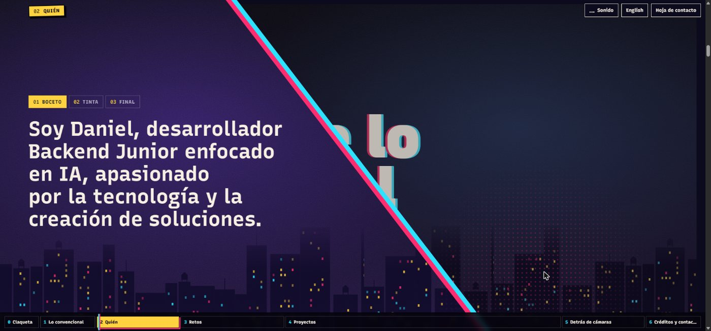
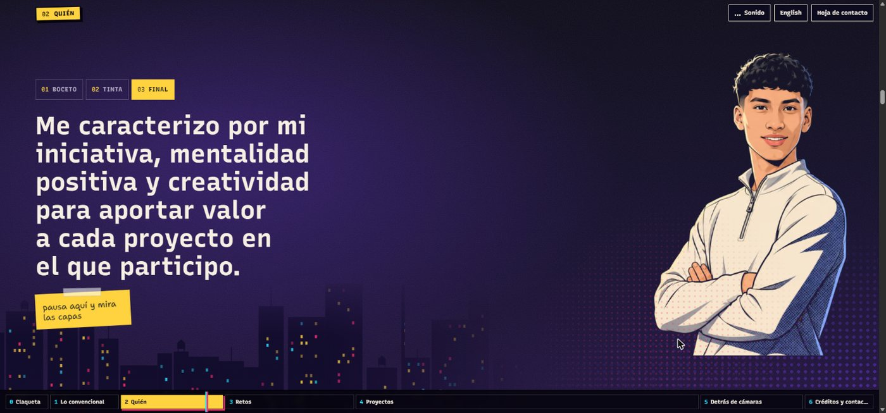
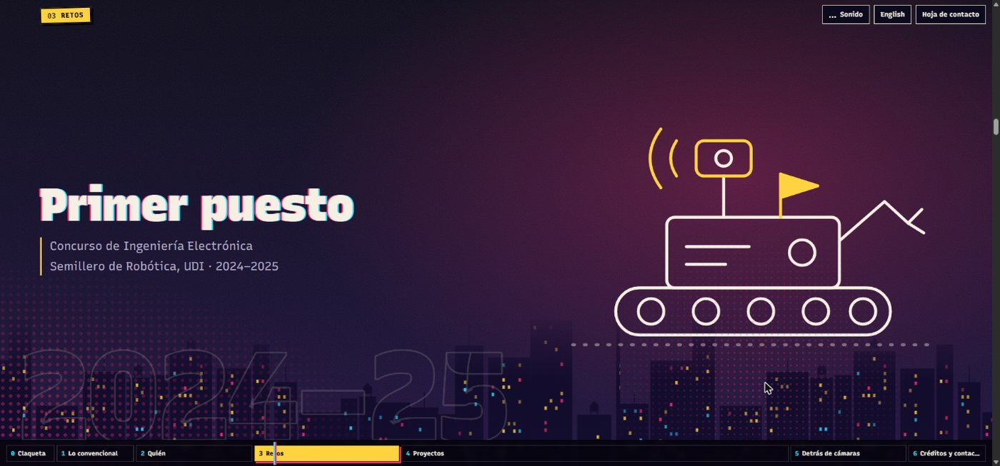
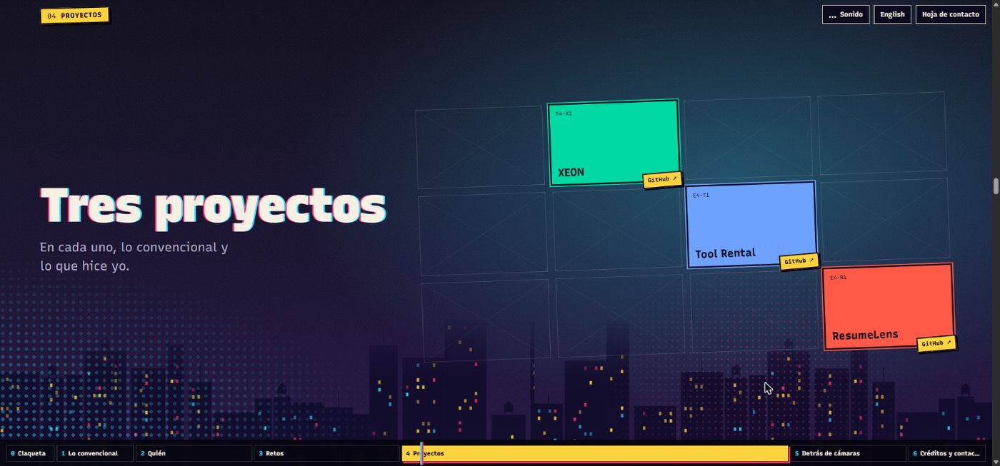
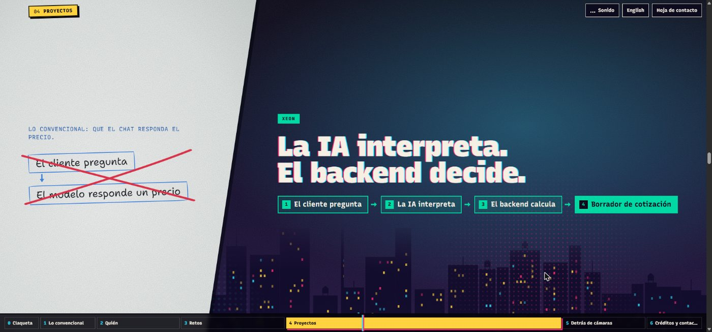
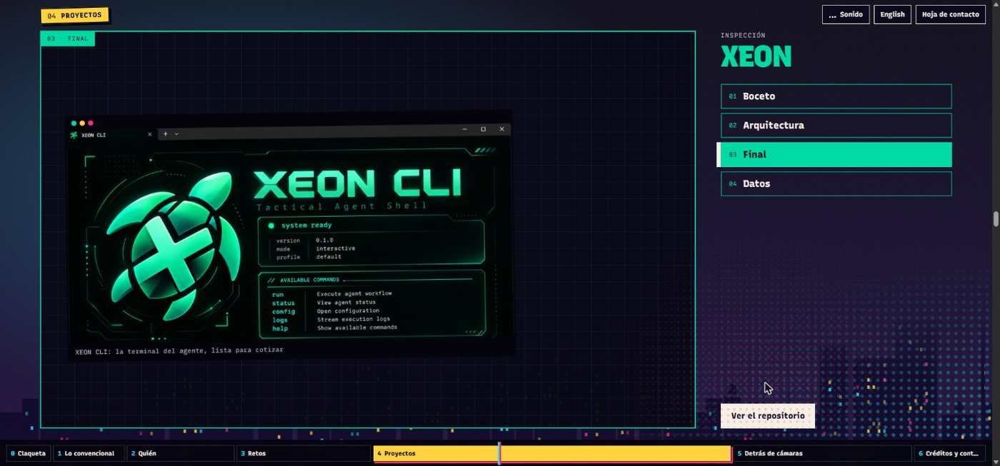
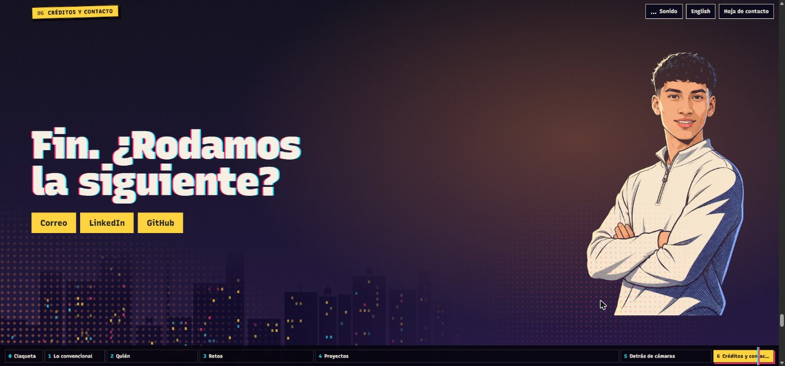
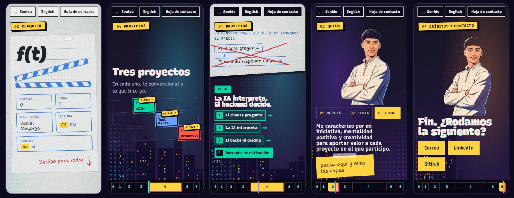

<div align="center">

<a href="https://dvanielx03.github.io/DanielVerse/"></a>

# DanielVerse · f(t)

**Un portafolio que se ve como una película. El cabezal de reproducción es tu scroll.**

[](https://astro.build)
[](https://www.typescriptlang.org)


[](https://dvanielx03.github.io/DanielVerse/)


**[▶ Ver en vivo](https://dvanielx03.github.io/DanielVerse/)** • [La idea](#la-idea) • [Capturas](#capturas) • [Las siete escenas](#las-siete-escenas) • [Cómo correrlo](#cómo-correrlo) • [Por dentro](#por-dentro) • [Estado](#estado)

</div>

Soy Daniel Mayorga, desarrollador Backend Junior enfocado en IA. Este es mi portafolio: en vez de una página con tarjetas, una película que avanza cuando deslizas y se detiene cuando te detienes.

> [!TIP]
> Está publicado en **[dvanielx03.github.io/DanielVerse/](https://dvanielx03.github.io/DanielVerse/)**. Mejor en un computador, con el sonido encendido (tecla <kbd>S</kbd>).

## La idea

> **Más allá de lo convencional.**

La película empieza como el portafolio de siempre, dibujado a lápiz. Tu scroll lo rompe, y lo que queda detrás es la película de verdad.

Todo el sitio es una función del tiempo, `f(t)`, donde `t` es cuánto has deslizado:

- **Mismo scroll, mismo fotograma.** No hay animaciones que arranquen solas y se pierdan: cada plano se calcula a partir de su avance.
- **Nada entra de golpe.** El scroll lleva inercia y cada sección llega con su propia transición: un tajo en diagonal, puntos de semitono que crecen, una viñeta que empuja a la anterior o un estallido de cómic.
- **Dos mundos.** El papel (boceto y tinta, claro y seco) y la ciudad de noche (el resultado final, con las tintas de imprenta a todo color). La capa decide la paleta.
- **El sitio reacciona.** Las tintas se separan cuando deslizas rápido y el cursor es una linterna que revela la trama de puntos.
- **Tres pasadas.** Cada cosa se ve primero como boceto, luego en tinta y al final en color, igual que en un estudio de animación.
- **Capas que se pueden mirar.** En cada proyecto puedes cambiar entre la idea a lápiz, la arquitectura y los datos.

## Capturas

<table>
  <tr>
    <td width="50%"><br><sub><b>0 · Claqueta.</b> Aquí se elige idioma y sonido.</sub></td>
    <td width="50%"><br><sub><b>1 · Lo convencional.</b> El portafolio de siempre, a lápiz.</sub></td>
  </tr>
  <tr>
    <td><br><sub><b>1 · La ruptura.</b> La hoja rota era una viñeta de la pared de storyboard.</sub></td>
    <td><br><sub><b>Transición.</b> Cada sección entra a su manera; esta, con un tajo.</sub></td>
  </tr>
  <tr>
    <td><br><sub><b>2 · Quién.</b> El avatar en tres pasadas, con selector.</sub></td>
    <td><br><sub><b>3 · Retos.</b> Los esquemas se dibujan mientras deslizas.</sub></td>
  </tr>
  <tr>
    <td><br><sub><b>4 · Proyectos.</b> Cada viñeta lleva a su escena y a su repositorio.</sub></td>
    <td><br><sub><b>4 · Díptico.</b> Lo convencional, tachado; lo que hice, al lado.</sub></td>
  </tr>
  <tr>
    <td><br><sub><b>4 · Inspección.</b> Boceto, arquitectura y datos de cada proyecto.</sub></td>
    <td><br><sub><b>6 · Contacto.</b> El cierre.</sub></td>
  </tr>
</table>



<sub>La misma experiencia a 340 px de ancho.</sub>

## Las siete escenas

| # | Escena | Qué pasa | Cómo suena |
|---|---|---|---|
| 0 | Claqueta | Una hoja sobre la mesa de luz. Eliges idioma y sonido. | Tono de sala y el golpe de la claqueta |
| 1 | Lo convencional | El portafolio de siempre se agrieta, resulta ser una viñeta de la pared de storyboard y la pared cae. | Lápiz y papel; después, la primera descarga |
| 2 | Quién | Mi presentación junto al avatar en boceto, tinta y final. | Suspenso: silencios, oleadas y golpes graves |
| 3 | Retos | Cuatro hitos en montaje rápido. | Descarga |
| 4 | Proyectos | [XEON](https://github.com/Dvanielx03/Xeon-agente-cotizaciones), [Tool Rental](https://github.com/Dvanielx03/Tool-rental-platform) y [ResumeLens](https://github.com/Dvanielx03/ResumeLens-cv): claqueta, díptico e inspección por capas, con acceso directo al código. | Suspenso, para poder leer |
| 5 | Detrás de cámaras | Cómo está hecha la película y mis herramientas propias. | Segunda descarga |
| 6 | Créditos y contacto | Créditos que suben y un iris que cierra. | El tema, lento y lejano |

Son 25 planos. Con las flechas <kbd>←</kbd> <kbd>→</kbd> saltas de plano; con <kbd>S</kbd> enciendes o apagas el sonido.

> [!NOTE]
> El sonido está apagado por defecto y no se descarga hasta que lo activas.

## Cómo correrlo

Necesitas [Node.js](https://nodejs.org) 22.23 o superior.

```bash
git clone https://github.com/Dvanielx03/DanielVerse.git
cd DanielVerse
npm install
npm run dev
```

Abre `http://localhost:4321`. La versión en inglés está en `/en/`.

| Comando | Qué hace |
|---|---|
| `npm run dev` | Servidor de desarrollo |
| `npm run build` | Genera el sitio estático en `dist/` |
| `npm run preview` | Sirve lo generado, tal como quedará publicado |
| `npm test` | Pruebas del motor de tiempo y de la mezcla de sonido |

> [!IMPORTANT]
> La animación usa funciones recientes de CSS (`round()`, `mod()`, `pow()`, `:has()` y `color-mix()`). Hace falta un navegador actualizado. Sin JavaScript o con movimiento reducido, la película se lee como un documento normal, plano a plano.

## Por dentro

El sitio es estático y no usa ninguna librería de animación. Hay tres piezas.

**1. El tiempo es puro.** `src/motor/tiempo.ts` convierte un instante en un plano y su avance. Mismo `t`, mismo resultado, y por eso se puede probar sin navegador.

```ts
const t = scroll / pantalla; // el instante, en pantallas de scroll
seek(t);                     // la película en ese instante, venga de donde venga
```

**2. La animación es una fórmula.** El motor solo escribe una variable por plano, `--p`, su avance de 0 a 1. El resto es CSS. La claqueta, por ejemplo, se cierra en cinco fotogramas:

```css
.claq {
  --cierre: round(down, clamp(0, calc((var(--p) - 0.3) / 0.4), 1), 0.2);
}
```

El instante que se pinta no es el del scroll tal cual: lo persigue con inercia, y de esa persecución sale la velocidad a la que reaccionan las tintas y el fondo.

**3. El sonido también es función de `t`.** `src/motor/mezcla.ts` decide qué capas suenan en cada plano, y una prueba vigila la regla principal: la descarga nunca suena mientras hay que leer. `src/motor/sintesis.ts` cruza las pistas de música según esa mezcla y sintetiza los efectos con Web Audio.

```text
src/
├── datos/        el storyboard como datos, en español e inglés
├── motor/        tiempo, scroll, mezcla y síntesis de sonido
├── components/   la película, el plano, la línea de tiempo y la hoja de contacto
│   └── arte/     una puesta en escena por tipo de plano
├── estilos/      tokens del sistema de diseño y estilos base
└── pages/        la ruta en español y la ruta en inglés
```

## Estado

En producción. Lo que hay y lo que falta, sin adornos:

- **Hecho:** las siete escenas con sus transiciones, la música, las dos versiones de idioma, la hoja de contacto como vía rápida y la [publicación en GitHub Pages](https://dvanielx03.github.io/DanielVerse/), que se actualiza sola con cada cambio en `main`.
- **Comprobado:** en Chromium de escritorio y a anchos de móvil desde 320 px.
- **Pendiente:** la capa «final» de cada proyecto con capturas reales, y probarlo en Firefox, Safari, un teléfono de verdad y con lector de pantalla.

## Créditos

- **Tipografías:** [Recursive](https://www.recursive.design) y [Shantell Sans](https://shantellsans.com).
- **Avatar:** generado con IA a partir de una foto real.
- **Música:** original, generada con ElevenLabs; el suspenso y el cierre se montaron a partir de esa misma grabación. Los efectos se sintetizan con Web Audio.
- **Lenguaje visual:** el del cómic impreso y el cine de animación que mezcla boceto, tinta, semitonos y color fuera de registro. No se usan personajes, arte ni música de terceros.

Si quieres hablar: [LinkedIn](https://www.linkedin.com/in/daniel-santiago-mayorga-tellez-5bb0463a0/) · [GitHub](https://github.com/Dvanielx03)

<details>
<summary><b>English</b></summary>

<br>

**DanielVerse · f(t)** is the portfolio of Daniel Mayorga, a Junior Backend Developer focused on AI, built as a film whose playhead is your scroll.

It opens as the usual portfolio, sketched in pencil. Your scroll breaks it, and the real film is behind: seven scenes, 25 shots, a creative transition into each section, two worlds (paper and a night city in comic-print inks), and every drawing shown as sketch, ink and final colour.

The site is static ([Astro](https://astro.build) and TypeScript) with no animation library. The engine writes one variable per shot, its progress from 0 to 1, and CSS does the rest. Sound is off by default; the music is original and generated with ElevenLabs.

See it live at **[dvanielx03.github.io/DanielVerse/](https://dvanielx03.github.io/DanielVerse/)**.

Run it with `npm install` and `npm run dev`. The English version lives at `/en/`.

</details>
